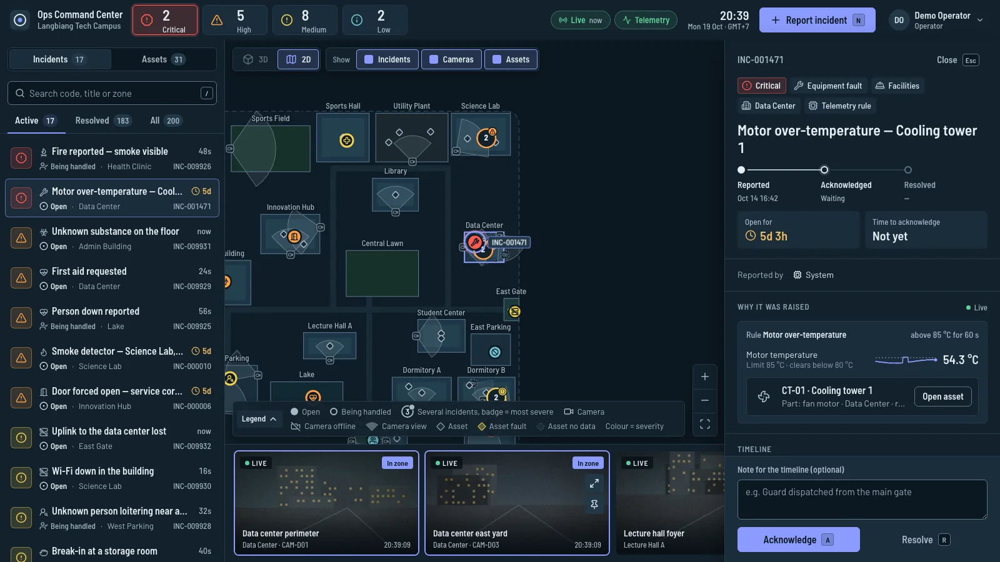
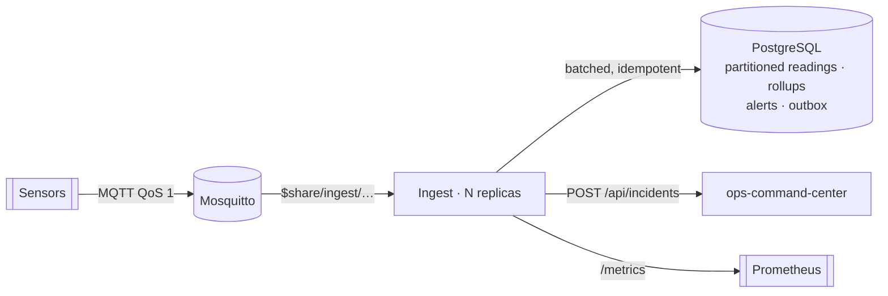
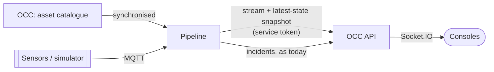

# IoT Telemetry Pipeline

[](https://github.com/truongtankhanh/iot-telemetry-pipeline/actions/workflows/ci.yml)


Sensor telemetry from a campus — server-room temperatures, CO₂ in lecture halls, power draw —
ingested over MQTT, stored in PostgreSQL, turned into alerts with hysteresis, and delivered as
incidents to [ops-command-center](https://github.com/truongtankhanh/ops-command-center).



_The incident above was raised by this pipeline: three readings over 27 °C opened an alert, the
outbox delivered it to ops-command-center, and when the temperature fell back below 25.5 °C the
incident was resolved automatically._

## Scope: V1, demo only

> **This is a V1 demonstration system. It is not intended for production use.** Devices and
> readings are synthetic, the broker allows anonymous clients, the HTTP API has no authentication,
> and some data-loss and metric-accuracy limits are known and open. The manifests and the
> platform-aws "production" stage show how it could be run, not that it should be.

Open issues are tracked as V1 tasks in [docs/tasks/v1](docs/tasks/v1/README.md). The next version
(V2) makes this pipeline the platform's single telemetry source: see
[ADR-0007](docs/adr/0007-pipeline-as-the-single-telemetry-source.md) and the [V2 tasks](docs/tasks/v2/README.md).

## Part of the campus operations platform

This service is one of three repositories that make up the platform:

| Repository                                                                 | Role                                                                     |
| -------------------------------------------------------------------------- | ------------------------------------------------------------------------ |
| **iot-telemetry-pipeline** (this repo)                                     | Sensor telemetry: ingest, storage, rollups, alerts                       |
| [ops-command-center](https://github.com/truongtankhanh/ops-command-center) | Operator console and API: incidents, site map, cameras, Keycloak sign-in |
| [platform-aws](https://github.com/truongtankhanh/platform-aws)             | AWS CDK that runs both on Fargate, RDS, CloudFront and AWS IoT Core      |

The pipeline owns telemetry; the command center owns incidents. Only a sustained, filtered breach
crosses between them — as an incident in the right zone, authenticated with client credentials.
Each side also runs without the other. What they exchange, and the values that must agree across
the repositories, are in [docs/system-context.md](docs/system-context.md).

## Highlights

- **≈ 24 500 messages/s (≈ 49 000 readings/s) end to end on one replica** — broker to committed
  rows, rollups and rules included — with zero loss and zero duplicates (median of three 200 000-message
  runs on an Apple M3 Pro, `main` at `ca25ec7`). [Benchmarks](docs/benchmarks.md#baseline-for-the-optimization-work)
- **Horizontal scale-out** with MQTT 5 shared subscriptions; replicas are stateless and race-safe.
- **Idempotent storage**: redelivered messages hit the primary key; rollups are computed from the
  rows actually inserted, so duplicates never inflate counts.
- **Completeness is measured**: per-device sequence numbers expose every lost message as a
  metric. In the first benchmark that metric caught a broker silently dropping 10 % of a burst
  under default settings — accounting for every one of 5 127 missing messages. The ledger is kept
  in PostgreSQL, so the count holds across replicas and connections; a gap is confirmed after a
  short grace period (`SEQUENCE_GRACE_MS`) so a late message is not mistaken for a lost one.
- **Alerts that don't flap**: consecutive-breach counts and separate clear thresholds.
- **Reliable delivery** through a transactional outbox, lease-based claiming and backoff.
- **No extensions required**: plain PostgreSQL with daily partitions, retention by `DROP TABLE`,
  and a documented TimescaleDB upgrade path.
- **Operable**: Prometheus metrics, liveness/readiness/startup probes, graceful drain on SIGTERM,
  Kubernetes manifests with HPA and PodDisruptionBudget.

## How it works



1. Devices publish `{ seq, ts, metrics }` to `campus/<zone>/<device>/telemetry`.
   The simulator in this repository stands in for real sensors; MQTT is used only up to the
   ingest service, and alerts reach ops-command-center over HTTP (step 5).
2. The service validates topic, device, zone and values; rejections are counted by reason.
3. Readings are buffered and flushed every 250 ms or 1 000 readings in one transaction:
   insert → roll up what was inserted → update `last_seen`.
4. Rules evaluate newly stored readings; opening or clearing an alert writes an outbox row in the
   same transaction.
5. The delivery worker creates the incident in ops-command-center, and resolves it when the
   alert clears.

Devices follow the [telemetry contract](docs/telemetry-contract.md); a rejected message is counted
by reason, never silently dropped.

Design and trade-offs: [architecture](docs/architecture.md) and seven ADRs —
[shared subscriptions](docs/adr/0001-mqtt-shared-subscriptions.md) ·
[ack on receipt, bounded loss](docs/adr/0002-ack-on-receipt-with-bounded-loss.md) ·
[partitions and rollups](docs/adr/0003-plain-postgres-partitions-and-rollups.md) ·
[rules with hysteresis](docs/adr/0004-rules-with-hysteresis.md) ·
[alert outbox](docs/adr/0005-alert-outbox.md) ·
[client credentials to the command center](docs/adr/0006-client-credentials-to-the-command-center.md) ·
[the pipeline as the single telemetry source](docs/adr/0007-pipeline-as-the-single-telemetry-source.md).

## Data flow with ops-command-center

**Today (V1) the data goes one way: from the pipeline to the command center, and only alerts cross.**
Readings, rollups and rule state stay in the pipeline's own database. The command center never
reads them and never calls this service's HTTP API; it receives incidents.

```mermaid
sequenceDiagram
  participant S as Sensors
  participant P as Pipeline (ingest)
  participant DB as PostgreSQL (telemetry)
  participant K as Keycloak (realm occ)
  participant O as OCC API
  participant C as Operators' console

  S->>P: MQTT readings (via the broker)
  P->>DB: readings and rollups, rules evaluated
  Note over P,DB: a breach that persists opens an alert;<br/>the alert and its outbox row are written together
  P->>K: client credentials, get a token
  P->>O: GET /zones (zone code to zone id)
  P->>O: POST /incidents (Idempotency-Key: telemetry-alert-id)
  O-->>C: incident in the right zone
  Note over P,O: when the value recovers, the alert clears<br/>and the worker calls POST /incidents/id/resolve
```

- **What crosses:** an incident when an alert opens, and its resolution when the alert clears. Field
  mapping, retries and the idempotency key are in [system-context.md](docs/system-context.md#22-pipeline--command-center-rest--oidc).
- **What does not cross:** raw readings, rollups, the device registry and the pipeline's HTTP API
  (`/api/devices`, `/api/alerts`). No known client calls that API yet; it is for operators and dashboards.
- **Each side works without the other.** With `OCC_API_URL` unset the pipeline still records alerts and
  marks their outbox rows `skipped`; the command center keeps its own telemetry path (its own broker,
  topics, rules and simulator) and does not pass through this pipeline.

**Planned, not built (V2 and V3, on hold until the command center's V2 is done):** the pipeline
becomes the platform's single telemetry source ([ADR-0007](docs/adr/0007-pipeline-as-the-single-telemetry-source.md)).
The decisions below may still change, because the integration approach is to be researched first.



- The command center owns the asset catalogue; the pipeline synchronises it and maps devices onto it.
- Realtime goes pipeline → OCC API → consoles. Consoles never connect to the pipeline.
- The command center drops its own MQTT path (V3) and reads telemetry through the pipeline only.
  Until then both paths coexist ([V1-T05](docs/tasks/v1/V1-T05-overlap-with-occ-telemetry.md)).
- Both services share one PostgreSQL database with one schema each and no shared tables.
- The pipeline's API and stream then become service-to-service interfaces with authentication
  ([V2 tasks](docs/tasks/v2/README.md)).

## Run it

```bash
pnpm docker:demo
```

Brings up PostgreSQL, Mosquitto, the ingest service and a simulator running the
`server-room-overheat` scenario. `pnpm docker:demo:down` removes the ingest and simulator containers
and leaves PostgreSQL and Mosquitto running; `pnpm docker:down` removes everything. Then:

```bash
curl localhost:3100/api/alerts                    # opens ~25 s after start, clears about a minute later
curl "localhost:3100/api/devices/dc-env-01/readings?metric=temperature_c"
curl localhost:3100/metrics | grep telemetry_     # throughput, rejections, gaps, lag
open http://localhost:3100/api/docs               # OpenAPI (API_DOCS_ENABLED, on in the demo)
```

Compose publishes PostgreSQL on `:5433` and Mosquitto on `:1883`. If either is taken on your
machine (`address already in use`), copy [`.env.example`](.env.example) to `.env`, set
`POSTGRES_HOST_PORT` / `MQTT_HOST_PORT` there, and use the same ports in the apps' own `.env`. Without the command center, alerts are recorded but not
delivered (outbox rows `skipped`).

**Together with ops-command-center:** its API requires a token from its Keycloak, which the
pipeline gets with client credentials ([ADR-0006](docs/adr/0006-client-credentials-to-the-command-center.md)).
Start the command center (`docker compose up --build` in that repo — console and Keycloak on
`:18080`), then run ingest on the host so the token's issuer is the same `localhost:18080` the
command center expects. `start` runs the built service, so install and build first:

```bash
# One `.env` per place: the root one (Compose ports) and one for each app
for d in . apps/ingest apps/simulator; do cp -n "$d/.env.example" "$d/.env"; done
# in apps/ingest/.env: uncomment OCC_* and set OCC_CLIENT_SECRET (the client's secret in the occ realm)
pnpm install && pnpm build
pnpm docker:up           # PostgreSQL and Mosquitto only
pnpm --filter @itp/ingest start
pnpm --filter @itp/simulator start -- --scenario server-room-overheat
```

Each app has its own README with its settings and commands: [ingest](apps/ingest/README.md),
[simulator](apps/simulator/README.md). Alerts appear in its console as incidents, reported by
`service-account-telemetry-pipeline`, and resolve themselves when values recover.

**Several replicas:** `pnpm bench:gaps` starts two ingest replicas on one broker and database,
publishes a burst and checks that the sequence-gap count stays at zero; `pnpm bench:gaps:loss` does
the same with a deliberately lossy broker and checks that every lost message is counted once
([benchmarks](docs/benchmarks.md#gap-count-across-replicas)). It builds an image and uses ports
`3101`, `3102`, `5434` and `1884`.

**Kubernetes (kind, k3d, minikube):**

```bash
docker build -f apps/ingest/Dockerfile -t telemetry-ingest:local .
kind load docker-image telemetry-ingest:local
kustomize build --load-restrictor LoadRestrictionsNone deploy/k8s/overlays/local | kubectl apply -f -
```

## Repository layout

```
apps/
  ingest/        NestJS service: MQTT consumer, batch writer, rules, outbox, API, metrics
    config/      devices.json (registry) and rules.json (thresholds) — reviewed as code
  simulator/     synthetic devices with scripted anomalies, and the benchmark
packages/
  telemetry-contract/   topic layout and payload parser shared by devices and service
deploy/
  mosquitto/     broker config (queue limits matter — see benchmarks)
  k8s/           kustomize base + local overlay
docs/            architecture, system context, contract, configuration, API, operations,
                 development guide, ADRs, benchmarks, roadmap
```

## Configuration

| Variable                                                | Default                 | Purpose                                                                             |
| ------------------------------------------------------- | ----------------------- | ----------------------------------------------------------------------------------- |
| `DATABASE_URL`                                          | —                       | PostgreSQL 14+                                                                      |
| `MQTT_URL`                                              | `mqtt://localhost:1883` | Broker                                                                              |
| `MQTT_SHARE_GROUP`                                      | `ingest`                | Shared-subscription group; empty disables sharing                                   |
| `MQTT_CONNECTIONS`                                      | `1`                     | Connections per replica in the group — for brokers that cap delivery per connection |
| `MQTT_CA_PEM` / `MQTT_CERT_PEM` / `MQTT_KEY_PEM`        | —                       | Mutual TLS from PEM text (AWS IoT Core); cert and key go together                   |
| `MQTT_CLIENT_ID_PREFIX`                                 | `ingest`                | Client ids are `<prefix>-<instance>-<n>`, so a broker policy can allow `<prefix>-*` |
| `FLUSH_INTERVAL_MS` / `FLUSH_MAX_READINGS`              | `250` / `1000`          | Batch triggers — bound the loss window on a hard crash                              |
| `BUFFER_MAX_READINGS`                                   | `20000`                 | Readings in memory before consumption pauses (database outage: the broker queues)   |
| `SEQUENCE_GRACE_MS`                                     | `30000`                 | How long a sequence gap stays open before it counts as lost                         |
| `RETENTION_DAYS`                                        | `30`                    | Raw readings and rollups kept                                                       |
| `OCC_API_URL`                                           | —                       | ops-command-center API; unset = alerts recorded, not delivered                      |
| `OCC_TOKEN_URL` / `OCC_CLIENT_ID` / `OCC_CLIENT_SECRET` | —                       | Client credentials for the command center's Keycloak (ADR-0006); all three or none  |

Also: `PORT` (3100), `MQTT_USERNAME` / `MQTT_PASSWORD`, `DELIVERY_INTERVAL_MS` (1000), `CONFIG_DIR`
and `MIGRATE_ON_BOOT` (true). Invalid configuration stops the service at startup with a list of
what is wrong. Every variable, plus the `devices.json` and `rules.json` formats, is documented in
[docs/configuration.md](docs/configuration.md).

## Quality

```bash
pnpm lint && pnpm typecheck
pnpm test        # rules engine, sequence gaps, rollups, partitions, backoff, sink, contract, simulator
                 # one package only: pnpm test:ingest, test:simulator, test:contract
pnpm e2e:ingest   # real PostgreSQL + real Mosquitto (pnpm docker:up) + a fake ops-command-center:
                 # storage, duplicates, rejections, alert open/deliver/clear/resolve, gaps, drain on shutdown
```

CI runs all of it, validates the Kubernetes manifests with kubeconform, and builds the images.
`pnpm ci:local` runs the same steps on your machine ([docs/development.md](docs/development.md#running-ci-on-your-machine)).

> The e2e suite recreates the `public` schema of `TEST_DATABASE_URL` (default `telemetry_test`), never
> of `DATABASE_URL`, and refuses to run unless the database name ends in `_test`. `pnpm e2e:ingest`
> points it at `telemetry_test` inside the Compose PostgreSQL
> ([V1-T03](docs/tasks/v1/V1-T03-e2e-wipes-database.md)).

## Documentation

| Guide                                                                | For                                                          |
| -------------------------------------------------------------------- | ------------------------------------------------------------ |
| [Architecture](docs/architecture.md)                                 | Problem, data flow, data model, delivery guarantees, scaling |
| [System context](docs/system-context.md)                             | How it fits with ops-command-center and platform-aws         |
| [Telemetry contract](docs/telemetry-contract.md)                     | Topic, payload, rejections, onboarding a device              |
| [Configuration](docs/configuration.md)                               | Environment variables, `devices.json`, `rules.json`          |
| [HTTP API](docs/api.md)                                              | Devices, readings, alerts, probes, metrics                   |
| [Operations](docs/operations.md)                                     | Metrics, alerts to set, outbox, failure modes, known limits  |
| [Development guide](docs/development.md)                             | Setup, code layout, tests, common changes                    |
| [Tasks: V1](docs/tasks/v1/README.md) · [V2](docs/tasks/v2/README.md) | Known risks and open decisions                               |
| [Benchmarks](docs/benchmarks.md) · [Roadmap](docs/roadmap.md)        | Measured throughput · what is next                           |

The full index is [docs/README.md](docs/README.md).

## License

[MIT](LICENSE) © Trương Tấn Khánh
