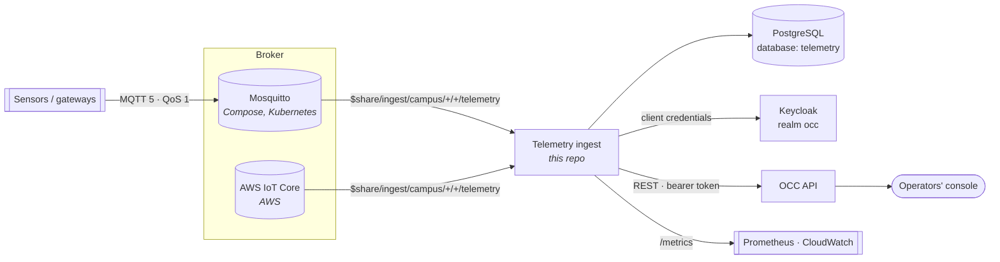
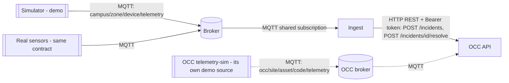
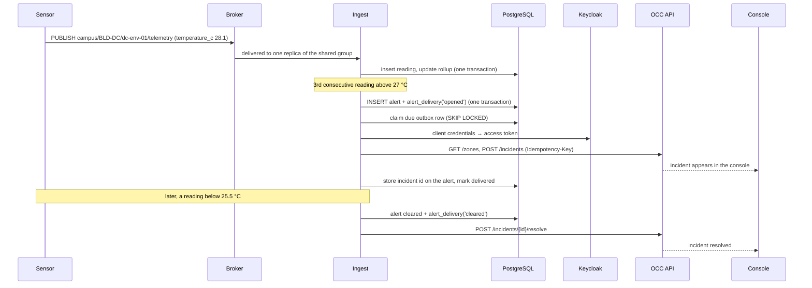

# System context

> **V1, demo only — not for production.** "Staging" and "production" below are the names of
> platform-aws stages, not a statement that the system is production-ready. Open risks are tracked
> in [V1 tasks](tasks/v1/README.md).

This repository is one of three that together form the **campus operations platform** for the
fictional Langbiang Tech Campus. This page describes where the pipeline sits, what it exchanges
with the other two, and which values must stay in agreement across repositories.

| Repository                                                                 | Role                                                                                   |
| -------------------------------------------------------------------------- | -------------------------------------------------------------------------------------- |
| **iot-telemetry-pipeline** (this repo)                                     | Sensor telemetry: MQTT ingest, storage, rollups, threshold alerts, alert delivery      |
| [ops-command-center](https://github.com/truongtankhanh/ops-command-center) | Operator console and API: live incidents, site map, cameras, Keycloak sign-in          |
| [platform-aws](https://github.com/truongtankhanh/platform-aws)             | AWS CDK infrastructure that runs both on ECS Fargate, RDS, CloudFront and AWS IoT Core |

Platform-wide decisions live in
[architecture-decisions](https://github.com/truongtankhanh/architecture-decisions); each repository
keeps the decisions that are its own (this one in [`docs/adr`](adr/)).

## 1. The platform at a glance

Two things to keep in mind when reading the diagram:

- **The pipeline owns telemetry data; the command center owns incidents.** Raw readings, rollups
  and alerts stay in the pipeline's own database. Only a sustained, hysteresis-filtered breach
  crosses into the command center, as an incident in the right zone.
- **The two sides are loosely coupled.** The pipeline works without a command center
  (`OCC_API_URL` unset: alerts are recorded and the outbox rows are marked `skipped`), and the
  command center works without the pipeline.

### 1.1 Which transport carries what

MQTT is used only between the sensors and the pipeline. Everything the pipeline sends to the command
center is plain HTTP.

- **Solid lines are this pipeline's path.** The simulator only publishes to the broker and knows
  nothing about the command center. The ingest service is the real product; the simulator stands in
  for sensors, and a real device that follows the [contract](telemetry-contract.md) replaces it
  without any change to ingest.
- **Dotted lines are the command center's own, separate telemetry path** (digital twin). It has its
  own broker setup, topic scheme and rules, and does not pass through this pipeline. Whether the two
  paths should converge is open: [V1-T05](tasks/v1/V1-T05-overlap-with-occ-telemetry.md).

## 2. Integration points

### 2.1 Devices → pipeline (MQTT)

Defined by [`@itp/telemetry-contract`](../packages/telemetry-contract/src/index.ts) and described
for firmware authors in [telemetry-contract.md](telemetry-contract.md).

| Item           | Value                                                                     |
| -------------- | ------------------------------------------------------------------------- |
| Topic          | `campus/<zoneCode>/<deviceId>/telemetry`                                  |
| Subscription   | `$share/<MQTT_SHARE_GROUP>/campus/+/+/telemetry` (default group `ingest`) |
| Protocol / QoS | MQTT 5, QoS 1                                                             |
| Payload        | `{ "seq": 42, "ts": "<ISO 8601>", "metrics": { "temperature_c": 24.3 } }` |
| Registry       | A device must be in [`devices.json`](../apps/ingest/config/devices.json)  |

### 2.2 Pipeline → command center (REST + OIDC)

Implemented by [`OpsCommandCenterSink`](../apps/ingest/src/delivery/ops-command-center.sink.ts) and
[`ClientCredentials`](../apps/ingest/src/delivery/client-credentials.ts); the reasoning is in
[ADR-0005](adr/0005-alert-outbox.md) and [ADR-0006](adr/0006-client-credentials-to-the-command-center.md).

| Step             | Call                                                                                                          |
| ---------------- | ------------------------------------------------------------------------------------------------------------- |
| Get a token      | `POST OCC_TOKEN_URL` with `grant_type=client_credentials` (Keycloak realm `occ`, client `telemetry-pipeline`) |
| Resolve the zone | `GET {OCC_API_URL}/zones` → map `zoneCode` to the zone id (cached in memory)                                  |
| Alert opens      | `POST {OCC_API_URL}/incidents` with header `Idempotency-Key: telemetry-alert-<alert id>`                      |
| Alert clears     | `POST {OCC_API_URL}/incidents/<id>/resolve` with a note; a `409` (already resolved) counts as success         |

How an alert becomes an incident:

| Incident field | Taken from                                                                    |
| -------------- | ----------------------------------------------------------------------------- |
| `type`         | the rule's `incidentType` in [`rules.json`](../apps/ingest/config/rules.json) |
| `severity`     | the rule's `severity`                                                         |
| `title`        | the rule's `title`                                                            |
| `description`  | device name and id, metric, value, time, alert id and rule id                 |
| `zoneId`       | looked up from the device's `zoneCode`                                        |

The service account holds the `technician` realm role. That role may report any incident but may
only resolve **Facilities** and **Environment** incidents, so every rule must use an incident type
from those categories (`equipment_fault`, `hvac_fault`, …). A rule with a security type would open
incidents the pipeline then cannot resolve. See the command center's incident categories in its
[incident API reference](https://github.com/truongtankhanh/ops-command-center/blob/main/docs/api/incidents.md).

### 2.3 Pipeline ↔ platform-aws

On AWS the pipeline runs unchanged as an ECS Fargate service. The infrastructure injects the same
environment variables used everywhere else:

| Variable                         | AWS value                                                                          |
| -------------------------------- | ---------------------------------------------------------------------------------- |
| `MQTT_URL`                       | `mqtts://<IoT Core endpoint>:8883`                                                 |
| `MQTT_CERT_PEM` / `MQTT_KEY_PEM` | from Secrets Manager; the private key never appears in CloudFormation              |
| `MQTT_CLIENT_ID_PREFIX`          | `ingest`, matched by the IoT policy `client/ingest-*`                              |
| `MQTT_SHARE_GROUP`               | `ingest`, matched by the policy's `topicfilter/$share/ingest/campus/+/+/telemetry` |
| `MQTT_CONNECTIONS`               | 2 (staging) / 4 (production), to get past IoT Core's 100 messages/s per connection |
| `DATABASE_URL` + `PGPASSWORD`    | RDS, database `telemetry`, `sslmode=verify-full`; password from Secrets Manager    |
| `OCC_API_URL`                    | `http://occ-api:3000/api` over ECS Service Connect                                 |
| `OCC_TOKEN_URL`, `OCC_CLIENT_ID` | the platform's Keycloak, client `telemetry-pipeline`                               |
| `OCC_CLIENT_SECRET`              | Secrets Manager, copied from Keycloak once by an administrator                     |

Metrics are scraped by an in-task OpenTelemetry collector into CloudWatch (namespace
`Platform/Telemetry`). The services are described in
[platform-aws architecture](https://github.com/truongtankhanh/platform-aws/blob/main/docs/architecture.md)
and [ADR-0003](https://github.com/truongtankhanh/platform-aws/blob/main/docs/adr/0003-aws-iot-core-as-the-broker.md).

## 3. Values that must agree across repositories

Nothing enforces these at build time; a mismatch shows up at runtime (a rejected message, a failed
delivery, a denied connection). Change them together.

| Value                     | Defined in                                             | Must match                                                                                  |
| ------------------------- | ------------------------------------------------------ | ------------------------------------------------------------------------------------------- |
| Zone codes (`BLD-DC` …)   | `devices.json` (`zoneCode`)                            | Zones seeded in ops-command-center; IoT thing attribute `zone` on AWS                       |
| Device id (`dc-env-01` …) | `devices.json` (`id`)                                  | MQTT topic segment; IoT thing name on AWS (a device may publish only as itself)             |
| Topic root and filter     | `telemetry-contract` (`campus/+/+/telemetry`)          | `TELEMETRY_TOPIC_FILTER` in the platform-aws telemetry stack and its IoT policies           |
| Share group               | `MQTT_SHARE_GROUP` (default `ingest`)                  | `SHARE_GROUP` in platform-aws; the `$share/ingest/…` grant in the ingest policy             |
| Client id prefix          | `MQTT_CLIENT_ID_PREFIX` (default `ingest`)             | `client/ingest-*` in the ingest IoT policy                                                  |
| Keycloak client           | `OCC_CLIENT_ID` (`telemetry-pipeline`)                 | Client in the `occ` realm of ops-command-center (`ops/keycloak/occ-realm.json`, its OCC-29) |
| Incident types            | `rules.json` (`incidentType`)                          | Types accepted by the command center, and the `technician` role's scope                     |
| Image name and tag        | `apps/ingest/Dockerfile`, `ghcr.io/…/telemetry-ingest` | `ingest` repository and `imageTag` in platform-aws                                          |
| Port and probe paths      | 3100, `/api/health`, `/api/ready`                      | Kubernetes manifests here; ECS health check in platform-aws                                 |
| Metric names              | [`metrics.ts`](../apps/ingest/src/metrics/metrics.ts)  | CloudWatch selectors and alarms in platform-aws                                             |

## 4. Deployment topologies

| Topology                           | Broker        | Database               | Alerts go to                      | Typical use               |
| ---------------------------------- | ------------- | ---------------------- | --------------------------------- | ------------------------- |
| `docker compose up`                | Mosquitto     | PostgreSQL container   | recorded only (no OCC configured) | Local development, demo   |
| Compose + a running command center | Mosquitto     | PostgreSQL container   | OCC on the host, via its Keycloak | Full local platform       |
| `deploy/k8s/overlays/local`        | Mosquitto pod | PostgreSQL StatefulSet | recorded only unless configured   | Local cluster (kind, k3d) |
| platform-aws (CDK)                 | AWS IoT Core  | RDS PostgreSQL         | OCC over Service Connect          | Staging and production    |

The pipeline's only coupling to the topology is configuration, never code: the broker, the
database and the command center are all reached through the variables in
[configuration.md](configuration.md).

## 5. One alert, end to end

## 6. Changing things safely

How to run and test across the repositories locally:
[development.md](development.md#working-across-the-three-repositories).

| If you change…                       | Also check                                                                                             |
| ------------------------------------ | ------------------------------------------------------------------------------------------------------ |
| A zone code or device id             | `devices.json`, OCC zone seed, IoT things and attributes, any firmware                                 |
| The topic layout or payload          | `telemetry-contract` (devices and service share it), IoT policies, the simulator                       |
| A metric name or its range           | `METRICS` in the contract, `devices.json`, `rules.json`, CloudWatch selectors                          |
| A rule's `incidentType`              | Whether the `technician` role may still resolve it                                                     |
| A Prometheus metric name or label    | platform-aws metrics sidecar declarations and alarms; any Grafana dashboard                            |
| Authentication to the command center | [ADR-0006](adr/0006-client-credentials-to-the-command-center.md), Keycloak client, platform-aws secret |
| The shutdown or drain time           | `stop_grace_period` (Compose), `terminationGracePeriodSeconds` (Kubernetes), `stopTimeout` (ECS)       |

## 7. Open points across the three repositories

These are known gaps between the repositories, recorded so they are decided deliberately rather
than discovered. Items 1 and 3 are tracked as
[V1-T05](tasks/v1/V1-T05-overlap-with-occ-telemetry.md) and
[V1-T01](tasks/v1/V1-T01-sequence-gap-metric-multi-replica.md).

1. **Two telemetry paths exist, and are being merged.** The command center has its own,
   asset-centric telemetry (digital twin, topic scheme `occ/<site>/asset/<code>/telemetry`, its own
   rules; its ADR-0018 and ADR-0019). The pipeline is device- and zone-centric
   (`campus/<zone>/<device>/telemetry`). The decision is taken in
   [ADR-0007](adr/0007-pipeline-as-the-single-telemetry-source.md): the pipeline becomes the single
   telemetry source in V2, with a realtime stream the command center API consumes; the command center
   drops MQTT in its V3; the command center keeps the asset catalogue; both systems share one
   PostgreSQL database with a schema each. Until the command center's V3, both paths coexist. This starts after the command center's V2 and an integration study; it is on hold. Plan:
   [V2 tasks](tasks/v2/README.md).
2. **Pipeline incidents cannot be told apart from manual ones.** They use ordinary facilities types;
   only the reporter (`service-account-telemetry-pipeline`) distinguishes them. Tracked as
   [ITP-15](roadmap.md).
3. **Sequence-gap metric versus multiple replicas.** `telemetry_sequence_gaps_total` is exact only
   when one process sees every message of a device. With several replicas or connections in a shared
   group it over-counts (see [operations.md](operations.md#known-limitations)), while platform-aws
   alarms on any increase. Expect the alarm to need a different signal before it can be trusted at
   more than one task.
4. **Dashboards and alert rules as code** are not shipped ([ITP-12](roadmap.md)); on AWS the signals
   go to CloudWatch, on premises nothing is provisioned.
5. **Device provisioning is manual** ([ITP-17](roadmap.md)): a new device is added to `devices.json`
   (and, on AWS, registered by hand as an IoT thing).
6. **AWS is synthesised and tested, not deployed from a live account**, so IoT policy evaluation and
   the collector's metric conversion are designed rather than observed (platform-aws status).
