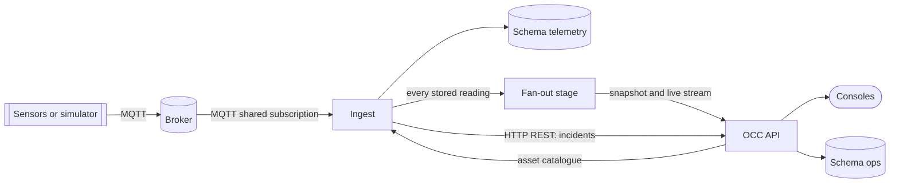

# Tasks (V2)

> **On hold.** V2 starts only after **ops-command-center V2 is done**, and after the integration
> approach has been researched. Until then these tasks are a plan, not a commitment: the three
> decisions in ADR-0007 are the working direction and may change with the research. Nothing in this
> folder is being implemented.

V2 turns the pipeline from "telemetry that raises incidents" into the platform's **single telemetry
source**, so that ops-command-center can drop MQTT in its V3. The direction and the three decisions
behind it are in [ADR-0007](../../adr/0007-pipeline-as-the-single-telemetry-source.md). V2 remains a
demonstration system, not intended for production use.

## Target shape

Both schemas live in one PostgreSQL database with separate roles. The command center never reads
the `telemetry` schema; it uses the pipeline's API and stream.

## Tasks

| ID                                                       | Title                                                                | Type     | Spans         |
| -------------------------------------------------------- | -------------------------------------------------------------------- | -------- | ------------- |
| [V2-T01](V2-T01-asset-catalogue-sync.md)                 | Synchronise the asset and point catalogue from the command center    | Feature  | itp, occ      |
| [V2-T02](V2-T02-rules-parity-and-evidence.md)            | Rules parity with the command center, and the incident evidence note | Feature  | itp, occ      |
| [V2-T03](V2-T03-realtime-stream-and-snapshot.md)         | Realtime stream and snapshot for the command center                  | Feature  | itp, occ      |
| [V2-T04](V2-T04-service-to-service-auth.md)              | Service-to-service authentication for the API and the stream         | Security | itp, occ, aws |
| [V2-T05](V2-T05-simulator-replaces-occ-telemetry-sim.md) | The simulator replaces the command center's `telemetry-sim`          | Feature  | itp, occ      |
| [V2-T06](V2-T06-single-database-two-schemas.md)          | One PostgreSQL database with a schema per system                     | Infra    | itp, occ, aws |

## Prerequisites from V1

| V1 task                                                        | Why it blocks or shapes V2                                                     |
| -------------------------------------------------------------- | ------------------------------------------------------------------------------ |
| [V1-T01](../v1/V1-T01-sequence-gap-metric-multi-replica.md)    | Completeness has to be measurable with several replicas                        |
| [V1-T02](../v1/V1-T02-failed-flush-drops-batch.md)             | The pipeline is the only source; a database outage must not lose data silently |
| [V1-T04](../v1/V1-T04-unauthenticated-api-metrics-docs.md)     | Absorbed by V2-T04                                                             |
| [V1-T06](../v1/V1-T06-no-contract-test-with-command-center.md) | The interface grows (catalogue, stream); drift would be costly                 |
| [V1-T05](../v1/V1-T05-overlap-with-occ-telemetry.md)           | Decision taken (ADR-0007); closes when the command center's V3 is done         |

## Suggested order

1. V1-T01, V1-T02 (foundations the stream relies on).
2. V2-T01 (catalogue) then V2-T02 (rules); the data model must exist before anything streams.
3. V2-T03 (stream and snapshot) with V2-T04 (auth) together: the interface is not usable without it.
4. V2-T05 (simulator parity), which also gives the command center's V3 a test source.
5. V2-T06 (database) last or in parallel; it is independent of the functional work.

The command center's V3 starts when V2-T03 and V2-T04 are usable. V3 is tracked in that repository.

## Open questions

- Does the command center keep a mock telemetry source for running without the pipeline, or does
  V3 require the pipeline for any telemetry at all? (Decides what `DEMO_MODE` and
  `TELEMETRY_SOURCE` become in V3.)
- Retention: the command center keeps seven days of telemetry history; the pipeline keeps thirty.
  Which one answers history queries for the console after V3?
- How are readings for assets that exist in the catalogue but have no registered device handled?
